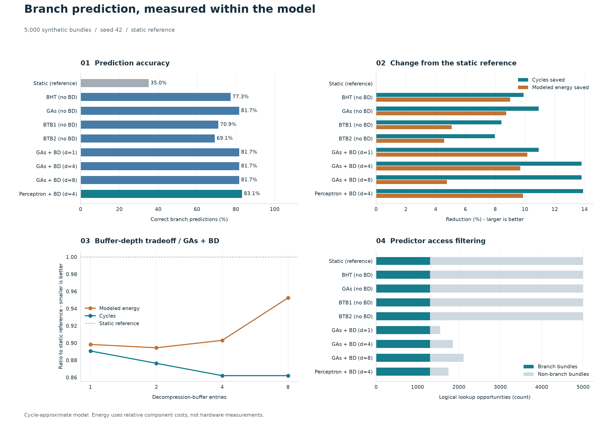
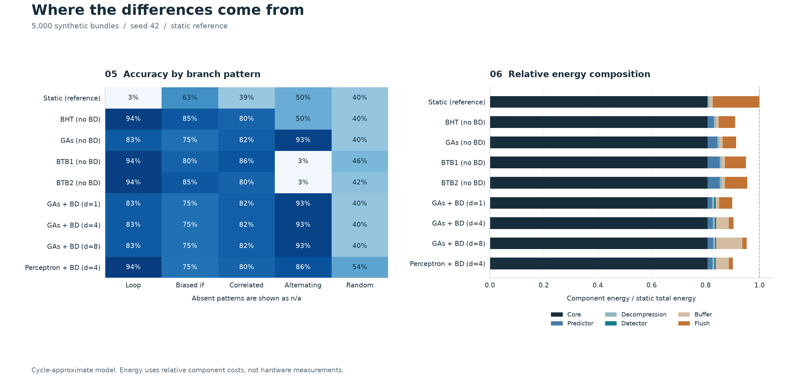

# VLIW Branch Prediction Lab

**Explore the tradeoff between branch prediction, execution cycles, and modeled energy.**

A Python simulation project comparing static, BHT, GAs, BTB, and perceptron predictors on a synthetic, 4-issue VLIW workload. An optional branch detector filters unnecessary predictor accesses; a buffer-depth sweep exposes the performance/energy tradeoff.

[Quick start](#quick-start) · [Results](#reference-experiment) · [Model notes](docs/methodology.md) · [Development](#development)



## What this project demonstrates

- **Architecture modeling:** bundle-level execution, branch-misprediction penalties, synthetic stalls, and buffer refill behavior.
- **Predictor implementation:** interchangeable static, 2-bit BHT, two-level GAs, tagged BTB, and online perceptron predictors.
- **Design-space exploration:** nine configurations and a separate 1/2/4/8-entry buffer sweep using the same workload.
- **Experiment tooling:** seeded runs, JSON/CSV exports, reusable plots, regression tests, and a CI workflow.

This is an educational, cycle-approximate model. Workloads are synthetic and energy costs are hand-selected relative units. Results are not measured silicon performance, physical power estimates, or a reproduction of the original paper's benchmark results.

## Quick start

Requires Python 3.10 or newer. From the repository root:

```bash
python -m venv .venv
# macOS/Linux: source .venv/bin/activate
# Windows PowerShell: .venv\Scripts\Activate.ps1
python -m pip install .
python -m branch_prediction_sim
```

The default run uses **5,000 bundles and seed 42**. It writes four files to `outputs/`:

| File | Contents |
| --- | --- |
| `overview.png` | Accuracy, cycle/energy reductions, buffer sweep, and accesses |
| `patterns_energy.png` | Per-pattern accuracy and component energy breakdown |
| `results.json` | Full results, seed, trace composition, model settings, and buffer sweep |
| `summary.csv` | One row per configuration for comparison or further analysis |

### Run another experiment

```bash
vliw-sim --bundles 20000 --seed 7 --output-dir outputs/seed-7
vliw-sim --seed 42 --no-plots
vliw-sim --show
python -m branch_prediction_sim --help
```

`--show` requires a working Matplotlib GUI backend; normal runs are headless. Use different output directories to retain multiple experiments. The original `python branch_prediction_sim/main.py` entry point still works.

## Reference experiment

These are **one seeded experiment**, not averages across real applications. All reductions are relative to the static, always-not-taken predictor on the same trace.

| Configuration | Accuracy | Fewer cycles | Speedup factor | Modeled energy saved |
| --- | ---: | ---: | ---: | ---: |
| Static reference | 35.0% | 0.0% | 1.000x | 0.0% |
| BHT, no detector | 77.3% | 9.9% | 1.110x | 9.0% |
| GAs, no detector | 81.7% | 10.9% | 1.123x | 8.7% |
| GAs + detector, depth 1 | 81.7% | 10.9% | 1.123x | 10.2% |
| GAs + detector, depth 4 | 81.7% | 13.8% | 1.160x | 9.7% |
| Perceptron + detector, depth 4 | **83.1%** | **13.9%** | **1.162x** | **9.9%** |

The perceptron configuration has the highest accuracy in this run. GAs with a depth-1 detector saves slightly more modeled energy. The comparison includes changes to both the predictor and buffer/detector settings; it does not isolate the benefit of the perceptron alone.

**Metric distinction:** 13.9% fewer cycles corresponds to about 1.162x speedup, assuming equal clock frequency. The earlier project output labeled cycle reduction as “speedup”; the revised export includes both measures explicitly.



Recreate the checked-in reference data and figures:

```bash
python -m branch_prediction_sim --bundles 5000 --seed 42 --output-dir outputs/reference
```

The checked-in [JSON report](docs/reference-run/results.json) records the model settings and Python version used for the reference run. See [methodology](docs/methodology.md) for formulas and limitations.

## How it fits together

```text
Seeded synthetic bundles
          |
          v
Predictor + branch detector + buffer configuration
          |
          v
Cycle counting + relative component energy accounting
          |
          v
Static-reference comparison --> JSON / CSV / figures
```

```text
branch_prediction_sim/
  cli.py              Experiment runner and exports
  core/               Workload generation, pipeline constants, energy costs
  predictors/         Static, BHT, GAs, BTB, and perceptron implementations
  bd/                 Branch detector and buffer assumptions
  simulation/         Trace simulation and configuration sweeps
  analysis/           Metric definitions and shared plotting code
docs/
  methodology.md      Assumptions, formulas, and interpretation
  reference-run/      Reproducible example data
  assets/             Figures used in this README
tests/                Behavioral and regression checks
```

## Development

```bash
python -m pip install -e .
python -m unittest discover -s tests -v
```

Tests cover predictor behavior, energy accounting, deterministic trace generation, metric denominators, the default experiment, result exports, and command-line entry points. A GitHub Actions workflow is included for Python 3.10/3.13 on Linux and Windows.

To add a predictor, implement `BasePredictor`, register it in `simulation/dse.py`, and add behavior tests. Keep generated runs in `outputs/`; only the documented reference run belongs under `docs/`.

## Background and attribution

The project is inspired by Palermo, Sami, Silvano, Zaccaria, and Zafalon, *Branch Prediction Techniques for Low-Power VLIW Processors* (GLSVLSI 2003). Its perceptron comparison uses the established method described by Jimenez and Lin, *Dynamic Branch Prediction with Perceptrons* (HPCA 2001).

The implementation, synthetic workload, and illustrative energy model are project choices. Adding a perceptron to this comparison does not establish a new branch-prediction algorithm. Other predictor references are retained in the source modules.
